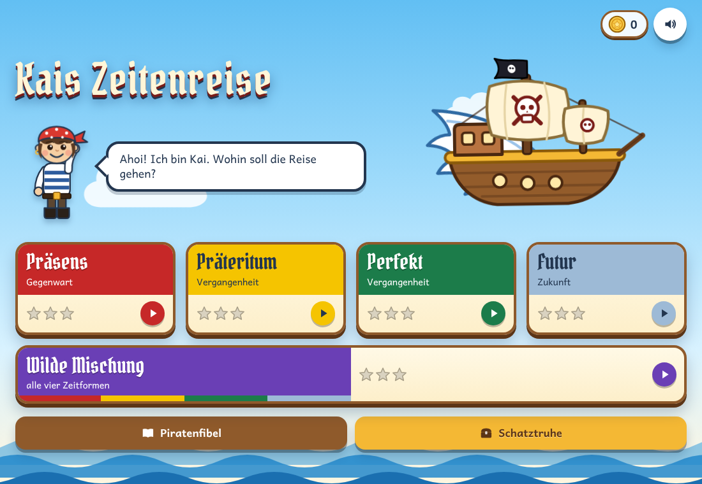
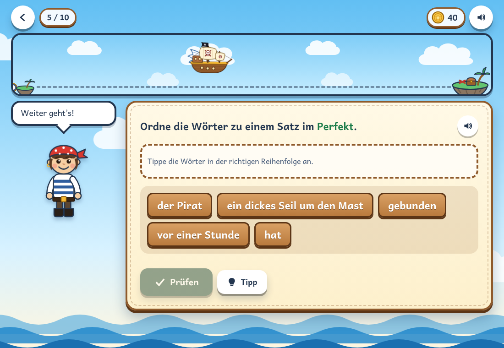

# Kais Zeitenreise

Eine Übungs-App für die Grundschule (Klasse 3 und 4): Die Kinder üben **Präsens, Präteritum, Perfekt und Futur**, begleitet von **Kai**, dem Piratenkind. Mit jeder gelösten Aufgabe fliegt Kais **fliegendes Piratenschiff** ein Stück weiter zur Schatzinsel.




## Was die App kann

- **Reise wählen:** Die Kinder üben eine einzelne Zeitform (Präsens, Präteritum, Perfekt oder Futur) oder die **Wilde Mischung** mit allen vier Zeitformen.
- **Vier Aufgabentypen**, die sich in jeder Reise abwechseln (10 Aufgaben pro Reise):
  - **Lückentext:** Verb in der richtigen Form eintippen (beim Perfekt und Futur zwei Lücken: Hilfsverb und Partizip bzw. Grundform).
  - **Auswahl:** die richtige von drei Verbformen antippen.
  - **Zeitform erkennen:** In der Wilden Mischung bestimmen die Kinder die Zeitform eines Satzes. In einer einzelnen Zeitform suchen sie den Satz, der in dieser Zeitform steht.
  - **Wörter anordnen:** Wortkarten per Tippen oder Ziehen in die richtige Reihenfolge bringen (Verb an zweiter Stelle, Partizip am Satzende).
- **Zwei Versuche pro Aufgabe:** Beim ersten Fehler gibt Kai einen Hinweis, der zum Fehler passt (zum Beispiel „Das ist das Präsens, gesucht ist das Perfekt“ oder „Prüfe das Hilfsverb: haben oder sein?“). Beim zweiten Fehler zeigt er die Lösung und alle vier Zeitformen des Verbs.
- **Belohnungen:** Goldmünzen, bis zu 3 Sterne pro Reise, fünf Ränge (Landratte bis Käpt'n) und 11 Abzeichen.
- **Fehler üben:** Nach jeder Reise können die Kinder die Aufgaben, die nicht geklappt haben, noch einmal üben. Auch in neuen Reisen kommen schwierige Aufgaben häufiger vor.
- **Kais Piratenfibel:** Eine Zeitreise-Leiste erklärt jede Zeitform mit Regel, Signalwörtern und Beispielen. Ein Beispielverb wird in allen vier Zeitformen gezeigt.
- **Vorlesen:** Ein Knopf liest die Aufgabe mit der Sprachausgabe des Geräts vor.
- **Offline-fähig:** Nach dem ersten Laden läuft die App auch ohne Internet. Sie lässt sich auf Tablets zum Startbildschirm hinzufügen.
- **Barrierefrei gedacht:** mit der Tastatur bedienbar, Farbkontraste nach WCAG AA (automatisch geprüft mit axe), Kais Rückmeldungen werden Screenreadern über eine Live-Region angesagt, die Einstellung „Bewegung reduzieren“ des Geräts wird beachtet. Mit einem echten Screenreader wurde die App noch nicht getestet.

Inhalt: 110 Piratensätze mit 70 Verben (regelmäßige, unregelmäßige, gemischte Verben, Verben mit sein/haben, Verben ohne „ge-“ im Partizip). Alle Verbformen werden aus einem Verblexikon erzeugt, deshalb passen Verb, Person und Hilfsverb immer zusammen.

## Auf GitHub veröffentlichen (GitHub Pages)

1. Auf github.com ein **neues Repository** anlegen, zum Beispiel mit dem Namen `zeitenreise`.
2. **Alle Dateien aus diesem Ordner hochladen** (Add file → Upload files). Dabei den *Inhalt* des entpackten Ordners hochladen, nicht die ZIP-Datei. Wichtig: auch die Ordner `css`, `js`, `fonts`, `icons` und die Datei `.nojekyll` müssen mit.
   Bei der Arbeit mit Git geht es so:
   ```bash
   git init && git add . && git commit -m "Kais Zeitenreise"
   git branch -M main
   git remote add origin https://github.com/BENUTZERNAME/zeitenreise.git
   git push -u origin main
   ```
3. Im Repository **Settings → Pages** öffnen. Bei „Build and deployment“ als Source **Deploy from a branch** wählen, Branch **main** und Ordner **/ (root)**, dann **Save**.
4. Nach ein bis zwei Minuten ist die App erreichbar unter
   `https://BENUTZERNAME.github.io/zeitenreise/`
5. Den Link an die Kinder oder Eltern geben (oder als QR-Code ausdrucken). Auf Tablets und Handys kann man die Seite über das Browser-Menü „Zum Startbildschirm hinzufügen“.

Hinweis: GitHub Pages ist bei öffentlichen Repositories kostenlos. In der App stehen keine personenbezogenen Daten, ein öffentliches Repository ist also unproblematisch.

### Lokal ausprobieren

Die Datei `index.html` lässt sich direkt per Doppelklick im Browser öffnen. Der Offline-Speicher ist dabei ausgeschaltet. Mit Offline-Speicher testet man über einen kleinen Server:

```bash
python3 -m http.server 8000
# dann im Browser: http://localhost:8000
```

## Die App anpassen

### Sätze und Verben ergänzen (`js/data.js`)

Jeder Satz ist eine Zeile `[Verb, Person, Subjekt, Rest]`:

```js
["laufen", "3s", "Kai", "über das Deck"],
```

| Person | Bedeutung |
|---|---|
| `1s` `2s` `3s` | ich, du, er/sie/es |
| `1p` `2p` `3p` | wir, ihr, sie |

- Das **Subjekt** schreibt man so, wie es *mitten im Satz* steht: Pronomen und Artikel klein (`ich`, `die Piraten`), Namen und Nomen groß (`Kai`, `der Papagei`).
- Der **Rest** ist ein Satzbaustein (Ort oder Objekt) und kommt hinter die Zeitangabe. Trennbare Verben (aufräumen, ankommen) bitte vermeiden.
- Aus diesen Angaben entstehen alle vier Zeitformen automatisch, zum Beispiel „Kai läuft jetzt über das Deck.“ / „Kai lief gestern über das Deck.“ / „Kai ist gestern über das Deck gelaufen.“ / „Kai wird morgen über das Deck laufen.“

**Neue Verben** trägt man im Lexikon `VERBS` ein:

```js
spielen: { pp: "gespielt" },                                   // regelmäßig
laufen:  { pres: "läuf", pret: "lief", pp: "gelaufen", aux: "sein" },   // unregelmäßig
bringen: { m: 1, pret: "brach", pp: "gebracht" },              // gemischt
```

`pp` ist das Partizip, `pret` der Präteritumstamm, `pres` der Stamm für du/er bei Vokalwechsel, `aux: "sein"` markiert Verben, die das Perfekt mit „sein“ bilden, `noGe: true` Verben ohne „ge-“ (verstecken → versteckt).

**Danach immer prüfen:**

```bash
node tools/check-data.js          # prüft alle Sätze und Aufgaben
node tools/check-data.js --print  # gibt alle Sätze zum Korrekturlesen aus
```

(Dafür wird Node.js benötigt. Die App selbst braucht es nicht.)

### Weitere Einstellungen

- **Texte von Kai, Ränge, Abzeichen, Zeitwörter** (gestern, morgen …) stehen ebenfalls in `js/data.js`.
- **Farben und Größen** stehen am Anfang von `css/style.css`.
- **Anzahl der Aufgaben pro Reise:** `var N = 10;` am Anfang von `js/app.js`.
- **Nach jeder Änderung** in `sw.js` die Zahl bei `CACHE` erhöhen (`kais-zeitenreise-v2` …), damit Tablets mit dem Offline-Speicher die neue Version laden.

### Adressparameter

| Adresse | Wirkung |
|---|---|
| `…/?sound=off` | Ton ist beim ersten Start aus (praktisch im Klassenraum) |
| `…/?bewegung=aus` | Animationen werden stark reduziert |

Der Ton lässt sich außerdem jederzeit mit dem Lautsprecher-Knopf oben rechts ein- und ausschalten.

## Datenschutz

- Die App sendet **keine Daten** an Server. Es gibt kein Tracking, keine Cookies, keine Anmeldung und keine externen Schriften oder Skripte.
- Münzen, Sterne und Abzeichen werden nur **im Browser des jeweiligen Geräts** gespeichert (`localStorage`), ohne Namen. Mehrere Kinder an einem Gerät teilen sich also den Spielstand. Unter „Meine Schatztruhe“ lässt sich der Fortschritt zurücksetzen.

## Aufbau

```
index.html          Einstieg
css/style.css       Gestaltung
js/data.js          Verben, Sätze, Texte, Abzeichen
js/logic.js         Konjugation, Aufgaben, Prüfung (ohne Oberfläche, testbar)
js/art.js           Grafiken (Kai, Piratenschiff, Inseln, Schatztruhe) als SVG
js/sound.js         Klänge (selbst erzeugt, keine Audiodateien)
js/store.js         Spielstand im Browser
js/app.js           Bildschirme und Spielablauf
js/pwa.js, sw.js, manifest.webmanifest   Offline-Betrieb und Startbildschirm-Symbol
fonts/              Andika und Pirata One (SIL Open Font License, Lizenzen liegen bei)
icons/              App-Symbole
tools/check-data.js Prüfwerkzeug für Sätze und Verben
```

Die App besteht aus reinem HTML, CSS und JavaScript ohne Build-Schritt und ohne Bibliotheken.

## Lizenz

Für den eigenen Code ist noch keine Lizenz festgelegt. Wenn das Repository öffentlich ist, lohnt sich eine Lizenzdatei, zum Beispiel MIT (bei GitHub: Add file → Create new file → `LICENSE`). Die Schriften unterliegen der SIL Open Font License 1.1 (siehe `fonts/`).
